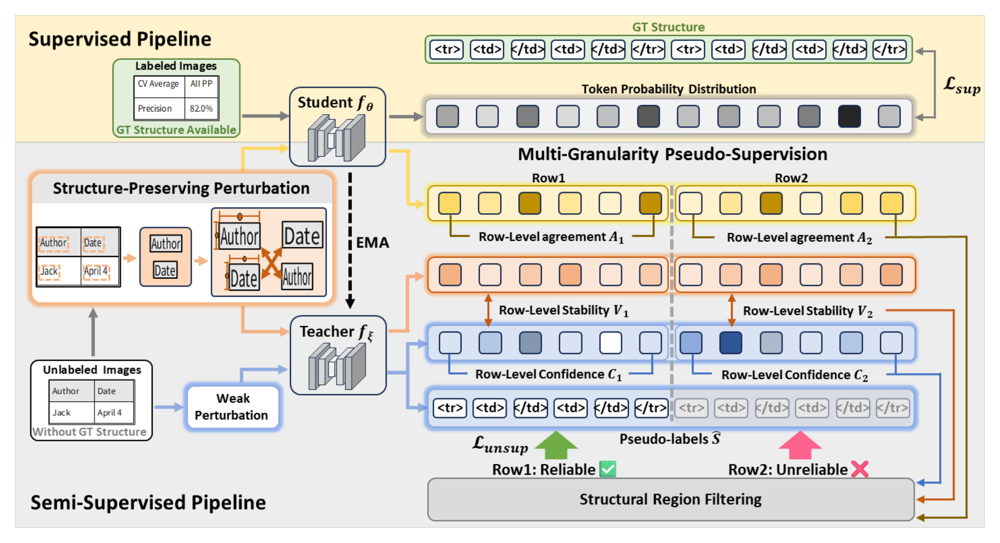

# RPS: Semi-supervised Table Structure Recognition

This repository contains the implementation of RPS, a semi-supervised framework for table structure recognition. RPS combines teacher–student learning, row-level pseudo-label selection, and structure-preserving perturbation to learn from limited labeled data and unlabeled images.



- **Pseudo-label selection (MPS):** Selects reliable pseudo-labels at the row level using confidence, stability, and teacher–student agreement.
- **Structure-preserving perturbation (SPP):** Uses offline OCR boxes to swap text regions within an image, increasing appearance variation while preserving table structure.
- **Teacher–student learning:** Updates the teacher with an exponential moving average (EMA) of the student parameters to generate structure pseudo-labels for unlabeled images.

## Installation

Environment: Python 3.8, PyTorch 1.10.0, and CUDA 11.3.

```bash
conda create -n rps python=3.8 -y
conda activate rps
conda install pytorch==1.10.0 cudatoolkit=11.3 -c pytorch -c conda-forge
python -m pip install -r requirements.txt
python -m pip install -e .
```

## Data Preparation

Prepare JSONL manifests for the labeled training set, unlabeled training set, and validation set, with one record per line. Image paths are relative to `--image-root`.

Labeled training and validation records require an image path and a structure token sequence. See [structure.txt](rps/vocab/structure.txt) for the vocabulary:

```json
{"image":"tables/table.png","structure":["<thead>","<tr>","<td></td>","</tr>","</thead>","<tbody>","<tr>","<td></td>","</tr>","</tbody>"]}
```

Unlabeled records require only an image path:

```json
{"image":"tables/unlabeled.png"}
```

Semi-supervised training also requires an offline OCR cache, with box coordinates defined on images resized with aspect ratio preserved and padded to 480 × 480. OCR is used only for image perturbation, not for generating structure pseudo-labels.

```json
{"img_path":"tables/unlabeled.png","boxes_xyxy_480":[[12,20,90,38],[110,20,188,38]]}
```

## Training

First, train on labeled data for supervised initialization:

```bash
python train.py \
  --mode supervised \
  --labeled manifests/labeled.jsonl \
  --val manifests/val.jsonl \
  --image-root datasets/images \
  --work-dir runs/supervised
```

Then, initialize from the supervised weights and run semi-supervised training:

```bash
python train.py \
  --labeled manifests/labeled.jsonl \
  --unlabeled manifests/unlabeled.jsonl \
  --val manifests/val.jsonl \
  --image-root datasets/images \
  --ocr-cache datasets/ocr_boxes.jsonl \
  --pretrained runs/supervised/ckpt/best_full.pth \
  --work-dir runs/rps
```

Replace the example paths with your own. Training settings are defined in [configs/rps.py](configs/rps.py), and logs and checkpoints are saved under `--work-dir`. Validation runs periodically during training using **TEDS-Struct**, which evaluates table structure without cell text.

## Code Structure

```text
train.py       Training entry point
configs/       Model and training configuration
rps/           Models, MPS, SPP, losses, training, and evaluation
tests/         Tests
```

## Acknowledgements

This project builds on implementations from MTL-TabNet, TableMASTER, and OpenMMLab. See [THIRD_PARTY_NOTICES.md](THIRD_PARTY_NOTICES.md) and [licenses/](licenses/) for third-party code and license information.
